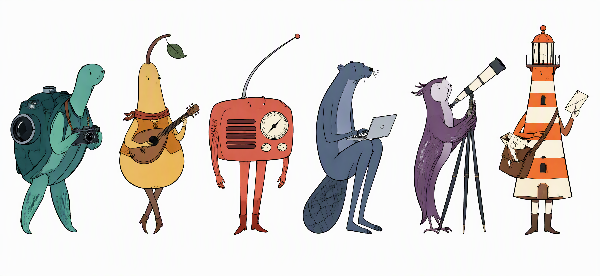

# Artist Storybook Character

<div align="center">

### 形有个性

从日常事物出发，探索角色的不同可能。

**手绘细线 · 独特比例 · 鲜明配色 · 克制表情**

[开始使用](#快速开始) · [查看 Skill](SKILL.md) · [输出规范](#输出规范) · [MIT 许可证](LICENSE)

</div>



<p align="center"><sub>AI 生成的视觉展示 · 横幅为独立创作，不是固定主提示的回归样本；Skill 默认逐个生成角色。</sub></p>

---

## 一种画风，多种可能

这是一套用于 AI 图像创作的**角色设计 Skill**。输入动物、物品、职业、动作或情绪，通过统一的艺术语言，探索它们成为角色后的形态。

它关注的不是同一副身体上的不同配饰，而是**轮廓、比例、姿态与结构本身的变化**。

| 线条 | 形态 | 色彩 | 表情 |
| :--- | :--- | :--- | :--- |
| 细而清晰的近黑色轮廓 | 用比例与负空间建立辨识度 | 干净、鲜明的哑光色块 | 微小的面部细节 |
| 手绘感来自线与形 | 不套用统一的吉祥物身体 | 不依赖光泽或脏纹理 | 安静、观察感与自然幽默 |

## 快速开始

> **需要什么？** 一个支持图像生成的 AI 助手。仓库提供创作指令，不包含图像模型或独立应用。

### 01 / 导入

下载或克隆仓库，按你所用助手的说明导入 [`SKILL.md`](SKILL.md)。

```bash
git clone https://github.com/davidai1024/artist-storybook-character.git
```

如果助手没有 Skill 导入入口，可让它读取 `SKILL.md`，并按其中的要求创作。不同环境的工具参数与保存路径需要适配。

### 02 / 给出描述

描述主体，也可以带上职业、动作或情绪。无需先替角色决定造型。

```text
使用 artist-storybook-character，生成一个「背着相机的红熊猫」。
```

| 你想探索的方向 | 输入示例 |
| :--- | :--- |
| 动物 × 职业 | 背着相机的红熊猫 |
| 物品 × 情绪 | 安静的水壶 |
| 动物 × 动作 | 穿雨衣散步的鸭子 |
| 多个独立形象 | 分别生成三个角色：水壶、鸭子、红熊猫 |

### 03 / 生成并验收

助手根据完整输入计算配色指令，填入固定主提示，再调用图像生成能力。拿到图片后，检查主体是否可辨认、轮廓是否完整，以及背景是否为真正的纯白色。

## 输出规范

| 项目 | 默认要求 |
| :--- | :--- |
| 构图 | **1:1**，一个完整角色，四周留白 |
| 背景 | **不透明纯白 `#FFFFFF`**，没有透明预览或棋盘格 |
| 分辨率 | 目标 **4K**；实际支持情况取决于图像服务 |
| 格式 | **PNG 位图**，不冒充 SVG 或可编辑矢量图 |
| 表面 | 均匀哑光色块，避免噪点、斑驳与脏纹理 |

## 一致的语言，不重复的模板

**固定的是创作方法，不是角色身体。** 每次使用相同主提示，让输入决定本次探索的主体。

配色根据输入文字的 UTF-8 字节计算 SHA-256，再生成三组 HSL 指令。相同的精确输入得到相同的配色指令；用户明确指定的颜色优先。

<details>
<summary><strong>关于生成结果与参考图</strong></summary>

- 配色指令可复算，**图片本身不保证复现**。重复生成或更换模型，造型可能变化。
- 图像模型不一定精确遵循 HSL 色值，配色与白底仍须验收。
- 默认每次独立创作，不借用之前生成的形象。
- 只有当前请求明确提供参考图并要求参考创作时，才使用该参考。
- 一句话中的多个属性作为一个角色概念处理；需要多张图片时，明确要求分别生成。

</details>

## 仓库结构

```text
artist-storybook-character/
├── SKILL.md          创作方法、主提示与验收标准
├── README.md         使用说明
├── LICENSE           MIT 许可证
└── assets/
    └── cover.png     首页视觉展示
```

## 开源与使用边界

Skill 与说明文档采用 **[MIT 许可证](LICENSE)**，允许使用、修改与再分发，并须保留版权与许可证声明。

MIT 仅覆盖本仓库提供的文本。展示图及生成图片的使用同时受所用图像服务条款和相关权利约束；本仓库不授予第三方商标或肖像权利，不包含私人资料或历史图片。

---

<p align="center">由 <a href="https://github.com/davidai1024">职场咸鱼</a> 创作与维护</p>
